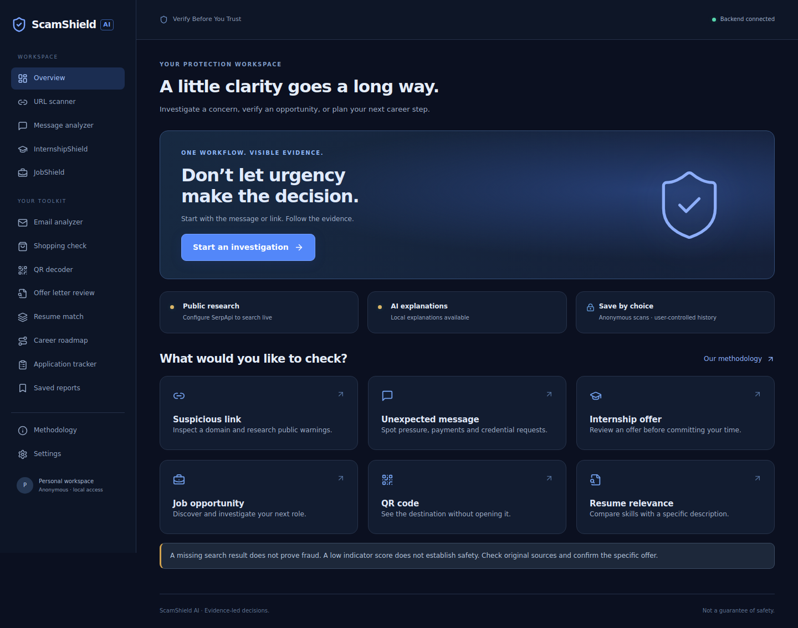
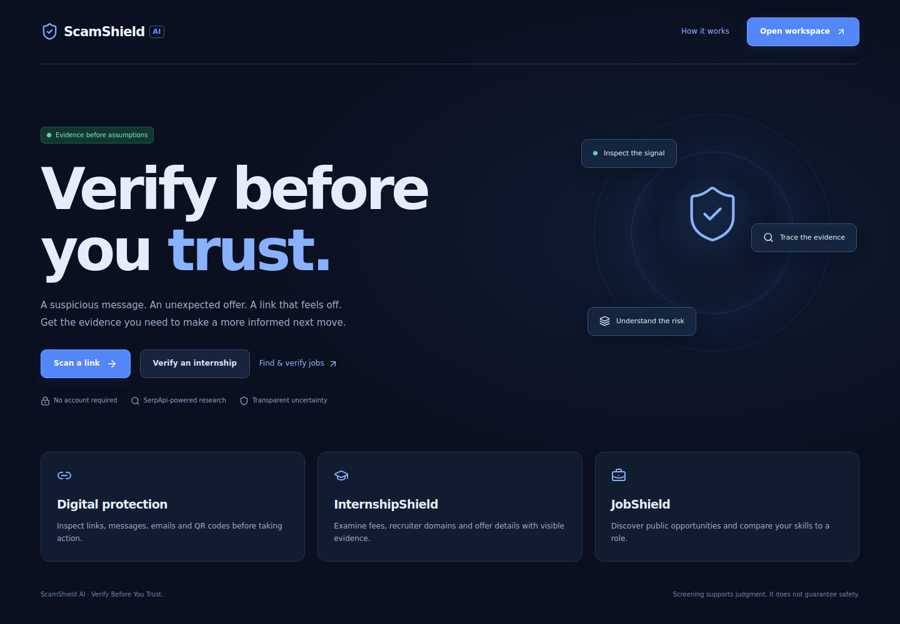

# ScamShield AI

**Verify Before You Trust.** A working local web application for suspicious-link/message screening, internship and job investigation, evidence reports and career tools.

This package includes the **Phase 1 MVP, Phase 2 workflows and selected extra tools**, plus full source code and a prebuilt frontend. It is not a claim that all 32 advanced ideas in the original brief are production-complete. See [exact feature coverage](docs/feature-status.md).

## Fastest start — Mac / Linux

Install **Python 3.12** (recommended; Python 3.11+ required). Extract the ZIP and open Terminal in the `scamshield-ai` folder:

```bash
bash start.sh
```

The first run creates a virtual environment, installs pinned Python dependencies and starts the application. Internet access is required for installation. The ZIP includes a compiled frontend, so Node is not required for this quick-start unless you modify/rebuild the frontend.

Open **http://127.0.0.1:8000**. Stop with **Ctrl+C**.

The script creates `.env` from `.env.example` if it is missing. Edit the root `.env` to add your own key:

```dotenv
SERPAPI_API_KEY=your_actual_key
```

Restart the app after changing `.env`. Enable “Research with SerpApi” in the scan form to consent to company/domain research. Job Search sends the entered criteria to SerpApi when you click Find jobs.

**No key:** local rules, QR decoding, PDF/text extraction, resume matching, roadmap, tracker and PDF reports still work. Live research shows an explicit configuration error. Job search cannot return live jobs without a key.

**Windows:** install Python 3.12 and run `start.bat`, then open the same address. The Windows launcher is provided but was not executed in the Linux validation environment.

## Optional AI explanations

Set all of the following in `.env`:

```dotenv
LLM_API_KEY=your_provider_key
LLM_BASE_URL=https://api.openai.com/v1
LLM_MODEL=your_available_model_id
```

Use an OpenAI-compatible Chat Completions provider that supports JSON object responses. Select a model available in your own account; no model ID or paid credentials are bundled. The provider URL is configured only by the server operator. Each analysis requires an explicit AI-sharing checkbox; full resumes and offer documents are not sent. Basic redaction is imperfect, so exclude sensitive details.

Without an LLM, report explanations use deterministic templates. The project does not train or bundle a machine-learning model. It implements a controlled investigation workflow and can integrate a hosted language model.

## What works

- React/TypeScript responsive landing page and workspace, accessible forms, errors and loading states.
- FastAPI + Pydantic, SQLite + SQLAlchemy, server-only secrets, owner-scoped saved data.
- URL, message, email, shopping, internship, job and offer-text screening.
- Recruiter/reference-domain mismatch, URL patterns, fee/OTP/urgency/guarantee/contract signals.
- Bounded SerpApi Google research with source links, query trace, timestamps and explicit failure states.
- Genuine SerpApi Google Jobs results with available source links, date and salary claims.
- QR decoding, local text-PDF/TXT extraction, explained keyword resume matching.
- Separate description-completeness score and sample-based job-market skill chart.
- Rule-based career roadmap, interview writing practice, saved applications and manual snapshot diffs.
- JSON report, PDF export, editable incident summary, local/optional AI follow-up explanations.
- Explicit save/delete history and complete workspace deletion.

Search excerpts are leads, not verified facts. The system never certifies an opportunity as safe. Heuristic risk scores are not fraud probabilities. Salary fairness, automated monitoring and other advanced features remain limited or planned as documented.

## Develop locally

Use Python 3.12 and Node.js 20+.

Terminal 1 — from project root:

```bash
cp .env.example .env
python3 -m venv backend/.venv
backend/.venv/bin/python -m pip install -r backend/requirements-lock.txt
cd backend
.venv/bin/python -m uvicorn app.main:app --reload --host 127.0.0.1 --port 8000 --no-access-log
```

Terminal 2 — from project root:

```bash
cd frontend
npm ci
npm run dev
```

Open http://localhost:5173. Vite proxies `/api` to the backend. Open http://127.0.0.1:8000/docs for interactive API documentation.

Build the UI after editing:

```bash
cd frontend
npm run build
```

Restart the backend to serve the updated built bundle on port 8000. `.env` belongs at project root; keys must never be placed in frontend source or `VITE_*` variables.

## Tests

Backend (from project root):

```bash
cd backend
.venv/bin/python -m pytest -q
```

Frontend typecheck + production bundle (from project root):

```bash
cd frontend
npm ci
npm run build
```

Browser tests (stop any server on port 8000 first):

```bash
cd frontend
npx playwright install chromium
npm run test:e2e
```

The browser test configuration uses `../backend/.venv/bin/python`. On Windows or a different environment set `PYTHON_BIN` to the appropriate Python executable. Browser tests create their own backend with blank provider keys and a separate e2e-test.db. Do not point automated tests at personal saved-data databases.

See [validation results](docs/validation.md) for checks actually executed. External services are mocked in automated tests; no live API success is claimed without keys.

## Project layout

```text
scamshield-ai/
  frontend/src/          React pages, UI, typed API client and hooks
  frontend/dist/         Prebuilt browser bundle included in ZIP
  frontend/e2e/          Browser workflow tests
  backend/app/           FastAPI, schemas, research, rules, files, persistence
  backend/tests/         Deterministic backend/integration tests
  docs/                  Architecture, API, feature status, demo and submission
  .env.example           Server-side configuration template
  start.sh / start.bat   Local launchers
  Dockerfile             Multi-stage container build
  docker-compose.yml     Persistent local Docker setup
```

`requirements-lock.txt` captures the tested Python environment. `requirements.txt` documents direct dependency ranges. The npm lockfile fixes frontend dependencies. No secrets, databases, uploaded personal files, virtual environments or node_modules are included in the ZIP.

## Deployment

For a local Docker instance:

```bash
cp .env.example .env
# Edit .env with your own values.
docker compose up --build
```

Open http://127.0.0.1:8000. Data lives in the `scamshield-data` Docker volume. Compose binds only to localhost by default. Docker files are supplied but were not built in this environment.

For a private server use the same image and a persistent volume at `/app/data`; configure environment variables with the hosting provider. Set an HTTPS reverse proxy with a request-body cap of 6 MB, short timeouts, authentication and external abuse controls before public access. Native PDF/image parsers should be isolated and resource-limited. The current single-process limiter and browser-held workspace token are local-MVP controls, not production identity or distributed quota infrastructure. See architecture.md.

SQLite is the tested database. PostgreSQL requires a SQLAlchemy driver such as psycopg, a supported URL, migrations and deployment testing. No untested PostgreSQL deployment is claimed.

## GitHub preparation

From the project root:

```bash
git init
git add .
git status
# Verify .env, databases and dependencies are absent from staged files.
git commit -m "Build ScamShield AI investigation MVP"
git branch -M main
git remote add origin https://github.com/YOUR_USERNAME/scamshield-ai.git
git push -u origin main
```

The prebuilt `frontend/dist` folder is ignored in Git because `npm run build` recreates it. It remains included in the download ZIP for easy startup. Review your chosen license before publishing; no external-service terms or branding rights are granted by this package.

Team of 3–5: frontend/UX; backend/data; research/AI; safety/testing; deployment/demo. For three people combine frontend+demo and backend+deployment. Use small feature branches and reviewed pull requests. Actual deadline and submission rules should be verified with the organizer.

## Documentation

- [Architecture and privacy](docs/architecture.md)
- [API reference](docs/api.md)
- [Feature-by-feature status](docs/feature-status.md)
- [Demo script](docs/demo-script.md)
- [Submission draft](docs/submission.md)
- [Original supplied brief](docs/original-project-brief.txt)

## Technical references

Integration parameters were checked against official documentation:

- https://serpapi.com/search-api
- https://serpapi.com/google-jobs-api
- https://fastapi.tiangolo.com/tutorial/request-files/

Only supported `google` and `google_jobs` engines are used. Job preferences/salary are query terms, not guaranteed filtering constraints. Search provider behavior and availability can change.

## Screenshots




